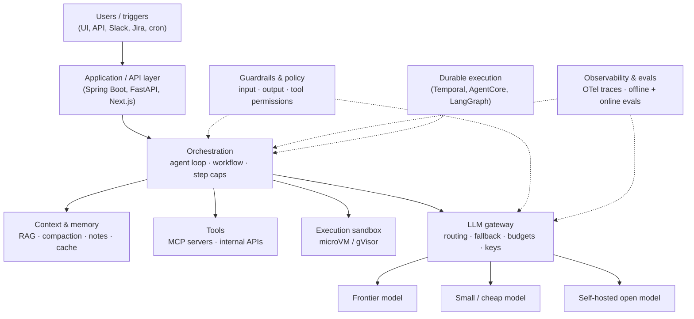
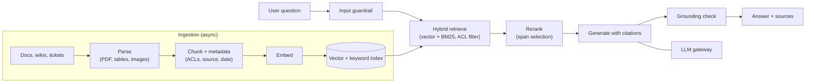
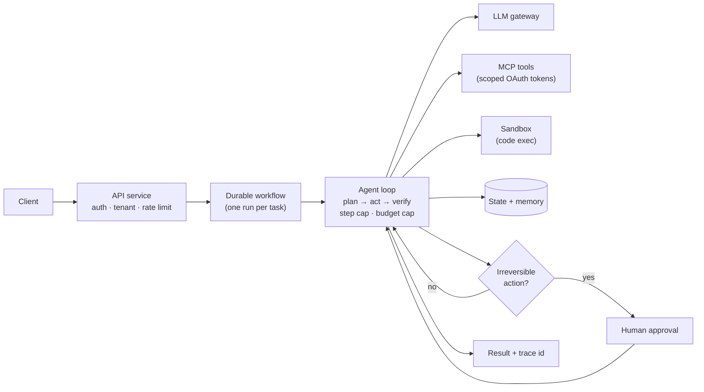
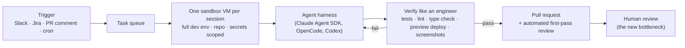
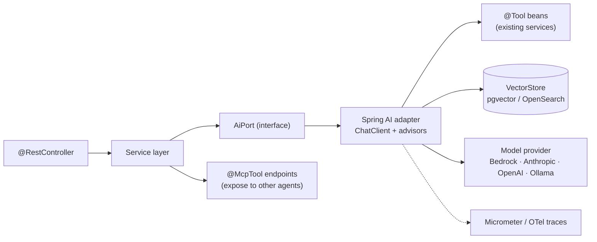

# AI system architecture (hub)

_Last updated: 2026-11-18 · Cadence: weekly (Mondays), plus anything exceptional_

> The end-to-end view: how models, gateways, orchestration, context, tools, sandboxes, guardrails, evals and observability fit together in a production AI system. This page **pulls together** material spread across other categories and links to them for detail. It adds reference architectures, a reliability checklist and decision records.

## 🧱 The layered stack

Production agent systems in 2026 tend to share the same layers. Start with the simplest system that works and add layers only when production needs justify them.

| Layer | Deep dive in this repo |
|---|---|
| Orchestration patterns | [Agentic workflows](agentic-workflows/README.md) |
| Context, memory, retrieval, caching | [Context engineering](context-and-memory/README.md) |
| Tools via MCP | [MCP servers](../build/mcp-servers/README.md) |
| Sandboxes, durable execution, hosting | [Agent infrastructure](agent-infrastructure/README.md) |
| Model choice, cost, self-hosting | [LLM news](../models/news/README.md) · [Inference & cost](../models/cost-and-serving/README.md) |
| Guardrails, permissions, injection | [AI security](security/README.md) |
| Tracing and evals | [Evals & observability](evals-and-observability/README.md) |
| Frameworks per language | [Libraries](../build/libraries/README.md) |
| AWS-managed equivalents | [AWS](../platforms/aws/README.md#-picking-an-aws-path) |

Sources: [Chip Huyen's AI Engineering architecture (summary)](https://agentic-ai.readthedocs.io/en/latest/ReferenceArchitecture/ai-engineering-architecture/) · [The 2026 AI agent stack](https://aiagentrank.io/blog/ai-agent-stack-2026) · [Agent platform architecture 2026](https://www.knowlee.ai/blog/ai-agent-platform-architecture-2026) · Added: 2026-11-18

---

## 🗺️ Reference architectures

### A · RAG assistant (knowledge Q&A with citations)

**Key decisions:** filter by user permissions *at retrieval time*, never after generation. A cheap embedding model plus a strong reranker usually beats one large embedding model. Run a grounding check before answering, such as Bedrock Guardrails contextual grounding or an LLM judge. Re-index incrementally on change events, not with nightly full rebuilds.
→ Models and patterns: [Context engineering](context-and-memory/README.md#-retrieval-models-embeddings-rerankers-parsers)

### B · Agentic backend service (tool-using agent behind an API)

**Key decisions:** keep tool calls idempotent and give each one an idempotency key, because retries *will* happen. Cap steps and spend per run. Put irreversible actions behind approval. Apply the Rule of Two per session. Persist the plan outside the chat history and re-inject it every step.
→ [AI security](security/README.md#the-lethal-trifecta--agents-rule-of-two) · [Case studies (Arize, PagerDuty)](../learn/case-studies/README.md)

### C · Background coding-agent platform (the "Ramp Inspect / Spotify Honk" pattern)

**Key decisions:** the agent must be able to **verify its own work** with the same tools an engineer uses, including tests, previews and screenshots. That is what separates high-adoption platforms from ones developers ignore. Give each session its own isolated sandbox, and plan for code review becoming the constraint.
→ Proof points in [Successful AI projects](../learn/successful-projects/README.md) · infrastructure in [details](agent-infrastructure/README.md)

### D · Adding AI to an existing Spring Boot service

**Key decisions:** hide the LLM behind a port interface so it can be tested and swapped. Use existing service methods as `@Tool`s rather than duplicating logic. Use Spring AI advisors for memory, RAG and guardrails. On AWS, deploy to AgentCore Runtime through the Spring AI AgentCore SDK if you need managed agent hosting.
→ [Libraries · JVM](../build/libraries/jvm.md) · [Starter skill](../build/agent-skills/starter-skills/spring-boot-kotlin/SKILL.md) · [AWS](../platforms/aws/README.md)

---

## 🚪 The LLM gateway layer

A gateway puts one endpoint in front of many providers and handles routing, fallback, retries, budgets, keys, caching and cost attribution in one place, so swapping models becomes a config change.

| Gateway | Shape | Pick when |
|---|---|---|
| **LiteLLM** | Python SDK + self-hosted proxy; retries then fallback across model groups | You want to self-host and control everything |
| **Portkey** | Gateway + observability + guardrails; OSS core + cloud; semantic cache | You want a full control plane with circuit breakers and caching |
| **OpenRouter** | Hosted marketplace, one key for many models | Fast access to many models without contracts |
| **Cloudflare / Vercel AI Gateway** | Managed edge gateways | You already run on that platform |
| **Kong AI Gateway / TrueFoundry** | Enterprise API-management style | Central platform teams with existing API governance |
| **Bedrock / AgentCore Gateway** | AWS-native routing with model fallback | AWS-first stacks |

**Caching caveat:** semantic response caching (returning a stored answer for a *similar* prompt) can cut costs on repetitive workloads but adds lookup latency. One vendor documents that matching ignores the system prompt, so namespace your caches. Provider prompt caching (exact prefix reuse) is a different mechanism and is always worth having.
Sources: [Arize: 6 LLM gateways for production](https://arize.com/resources/best-llm-gateways-comparison/) · [Requesty gateway comparison](https://www.requesty.ai/blog/litellm-vs-portkey-vs-openrouter-best-llm-gateway-2026) · Added: 2026-11-18

---

## 🛡️ Reliability checklist

- [ ] **Timeouts** on every model and tool call; **streaming** for user-facing latency.
- [ ] **Retries with backoff**, plus **fallback** to a second model or provider through the gateway.
- [ ] **Circuit breakers** per provider, so you degrade instead of piling on.
- [ ] **Idempotency keys** on tool calls that change state.
- [ ] **Step caps and budget caps** per run; loops are the most common production failure.
- [ ] **Durable execution** for anything longer than one request.
- [ ] **Graceful degradation**: smaller model, cached answer, or "a human will follow up".
- [ ] **Model cascade**: try a small model first and escalate on low confidence or failed validation.
- [ ] **Structured outputs validated** (JSON schema, Zod, Pydantic) before anything acts on them.

## 🎯 Where guardrails and evals sit

| Stage | Guardrail | Eval |
|---|---|---|
| Input | Injection and PII screening, auth and tenant checks | — |
| Retrieval | ACL filtering, freshness | Retrieval hit-rate on a golden set |
| Tool call | Allow-list, scoped tokens, approval for irreversible actions | Decision-point tests |
| Output | Schema validation, grounding check, policy filters | LLM-judge rubric scores |
| Deploy | — | **Offline eval gate in CI**: no merge if the score drops |
| Production | Tripwires on cost and unsafe branches | **Sampled online evals** on live traces, with alerts |

Eval-as-a-gate, policy-as-code at runtime and an immutable evidence store are the 2026 upgrades enterprises are adding. ([Enterprise AI reference architecture](https://enterprisedataairealities.substack.com/p/enterprise-ai-reference-architecture) · [Control-plane patterns](https://urandom.io/blog/2026-02-23-agentic-ai-control-plane-patterns-for-memory-routing-and-evals))

---

## 📝 Architecture decision records

| Decision | Default | Choose the alternative when |
|---|---|---|
| Framework vs hand-rolled loop | Hand-roll first, adopt a framework when it removes code you'd maintain | You need memory, durable runs, tracing or MCP plumbing out of the box |
| Single agent vs multi-agent | **Single agent** | Truly parallel, breadth-first work, or hard permission boundaries. Committees of reviewers mostly add cost ([details](agentic-workflows/README.md#-latest-evidence-what-actually-moves-the-needle)) |
| Managed vs self-hosted models | Managed API | Data residency, very high steady volume, or offline needs ([details](../models/cost-and-serving/README.md#-self-hosting--serving)) |
| RAG vs fine-tuning | **RAG** for knowledge | Behaviour, format or domain-reasoning gaps ([details](../models/fine-tuning/README.md)) |
| Direct SDK vs gateway | SDK for one provider | More than one provider, or you need budgets, fallbacks and keys centrally |
| Container vs microVM sandbox | microVM or gVisor for agent-written code | Trusted, first-party code only |
| Build vs buy a coding-agent platform | Buy (Claude Code, Codex, Cursor, Devin, Kiro) | Unique internal tooling and verification needs, as Ramp, Spotify and Stripe had |

## 📚 Further reading
- [LLM eval stack: a reference architecture for 2026](https://futureagi.com/blog/llm-eval-stack-reference-architecture-2026/)
- [How to productionize agentic applications (9 steps)](https://futureagi.com/blog/how-to-productionize-agentic-applications/)
