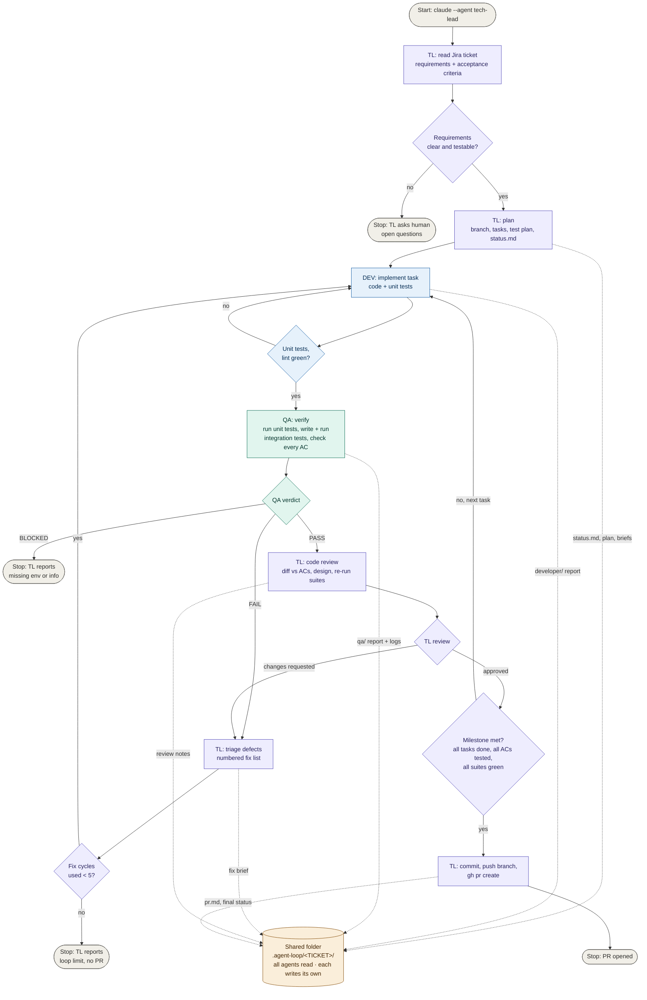

# Jira ticket agent loop (Claude Code)

A three-role loop for taking one Jira ticket from requirement to an open pull request in Claude Code. The **Tech Lead** runs as the main thread. It delegates to a **Developer** subagent (code + unit tests) and a **QA** subagent (acceptance criteria + integration tests), reviews the result, and repeats until the milestone is met. Then it opens a PR and stops.

| Role | File | Writes | Model |
|---|---|---|---|
| Tech Lead (orchestrator) | [agents/tech-lead.md](agents/tech-lead.md) | Shared folder root and `tech-lead/`, plus git and the PR | `opus` |
| Developer | [agents/developer.md](agents/developer.md) | Production code, unit tests, shared `developer/` | `sonnet` |
| QA | [agents/qa.md](agents/qa.md) | Integration tests, test fixtures, shared `qa/` | `sonnet` |

## Shared folder

Every agent starts each delegation with a fresh context. `.agent-loop/<TICKET>/` holds the loop's state on disk so that nothing depends on what an agent remembers. **Every agent can read all of it. Each role writes only its own files**, so no agent overwrites another's record.

```text
.agent-loop/<TICKET>/
├── status.md                 TL  live state: ACs, tasks, fix cycles, log
├── pr.md                     TL  PR body passed to gh pr create
├── tech-lead/
│   ├── plan.md               TL  tasks + test plan (which AC is unit vs integration)
│   ├── briefs/               TL  dev-T1.md, qa-T1.md, fix-1.md …
│   └── reviews/              TL  review-1.md … (verdict + numbered change list)
├── developer/                DEV T1.md, fix-1.md … (DEV reports)
└── qa/                       QA  T1.md, fix-1.md … (QA reports, AC coverage, defects)
    └── logs/                 QA  raw unit + integration test output
```

The folder is scratch state for one ticket and is never committed. Add `.agent-loop/` to `.gitignore`.

## The loop



Purple is the Tech Lead, blue is the Developer, green is QA, and grey nodes are start and stop points. The amber cylinder is the shared folder. Dashed arrows show what each step writes there. There are four ways out of the loop. Only one of them opens a PR.

## Setup

1. Copy the agents into the target repo so Claude Code can find them:
   ```bash
   mkdir -p .claude/agents
   cp <path-to>/build/claude-code-agent-loop/agents/*.md .claude/agents/
   ```
2. Give the Tech Lead access to Jira. Connect a Jira MCP server, then add its tool names (`mcp__<server>__…`) to the `tools:` line in `tech-lead.md`. Otherwise, paste the ticket into the prompt below.
3. Make sure `gh auth status` succeeds and the repo's unit and integration test commands run locally.
4. Add `.agent-loop/` to `.gitignore`. It's the [shared folder](#shared-folder) the agents use to hand work to each other.
5. Start the session with the Tech Lead as the main thread:
   ```bash
   claude --agent tech-lead
   ```
   With `--agent`, the main thread takes the Tech Lead's system prompt, model and tool restrictions. `Agent(developer, qa)` in its `tools` means it can spawn only those two subagents.

## Kick-off prompt

Fill in the placeholders and paste this as the first message:

```text
Ticket: <JIRA-KEY>
(If Jira tools are unavailable, the ticket text is pasted below.)

Default branch: <main>
Unit test command: <e.g. ./gradlew test | npm test | pytest -m "not integration">
Integration test command: <e.g. ./gradlew integrationTest | npm run test:int | pytest -m integration>
Lint / typecheck command: <optional>
Environment notes: <e.g. docker compose up -d db before integration tests>

Run the Jira ticket loop for this ticket:
1. Read the ticket and confirm the acceptance criteria are clear and testable. If not, list the open questions and stop.
2. Create the feature branch, set up the shared folder .agent-loop/<JIRA-KEY>/
   (status.md, tech-lead/plan.md, developer/, qa/), and plan the tasks and test plan.
3. For each task: write the brief to tech-lead/briefs/, then delegate implementation to `developer`
   and verification to `qa`. Each writes its report to its own subfolder.
   On QA FAIL or review "changes requested", send a numbered fix list back to `developer`.
   Keep at most 5 fix cycles; at the limit, stop and report without opening a PR.
4. When QA passes, review the diff against every AC and re-run both test suites yourself.
5. When the milestone is met (all tasks done, every AC covered by a passing test,
   both suites green, QA PASS, review approved), commit, push the branch, open the PR
   with `gh pr create`, print the PR URL, and stop.

Keep status.md updated after every step. Don't merge the PR.

<paste ticket text here if needed>
```

## Why it's shaped this way

- **The Tech Lead never edits code.** Review only means something when the reviewer didn't write the change. This is enforced in its prompt, and its write access is meant only for the shared folder.
- **The shared folder holds state on disk.** Briefs, reports and logs outlive each subagent's context, so a fix cycle can point to `qa/T1.md` instead of pasting it again. A human can also watch progress or pick the loop up after a stop. Each role writes only its own files, so the record of who said what stays trustworthy.
- **QA works in a fresh context.** QA doesn't see the developer's reasoning, only the ACs and the changed files, so it tests the requirement and not the implementation.
- **The milestone is a checklist.** The loop ends when every box in the Tech Lead's milestone check is ticked, not when an agent says it's done.
- **There's a fix-cycle cap.** Without one, a bad ticket or a flaky environment loops forever. Five cycles, then stop and hand the problem to a human.

Sources: [Claude Code subagents](https://code.claude.com/docs/en/sub-agents) (frontmatter fields, `--agent`, `Agent(...)` allowlist) · [GitHub CLI `gh pr create`](https://cli.github.com/manual/gh_pr_create)
